# 售后智答(After-Sales Intelligent Q&A Platform)

基于 **FastAPI + HTML/CSS/JS + MySQL + Redis + Milvus + LangGraph + RAG + MCP** 的电商售后智能客服系统。
覆盖意图识别、情感分析、知识库检索增强、多步 Agent 工具调用、复合任务办理、
MCP 工具服务化、Langfuse 全链路观测、转人工、数据看板与知识库运营。

> 演示入口:[可复现演示脚本](docs/DEMO.md) · [架构设计](docs/ARCHITECTURE.md) ·
> [ADR-0001:LangGraph 主路径 + 强停兜底](docs/adr/0001-langgraph-primary-agent.md)

## 功能

- **7×24 智能对话**:多轮上下文、意图路由、快捷回复
- **意图识别**:关键词规则 + LLM 融合,支持订单号/手机号/商品名/价格/日期实体抽取
- **情感分析**:词典 + 规则,负向情绪安抚并自动转人工
- **RAG 2.0 知识库**:BGE + Milvus 向量检索叠加 BM25、RRF 融合、本地 bge-reranker 重排,
  回答附带结构化引用(citations)
- **模型可切换**:本地 BGE 默认;`EMBEDDING_PROVIDER` / `RERANK_PROVIDER`
  可切 OpenAI 兼容远程 embedding 与 SiliconFlow rerank,失败自动降级
- **证据闸**:Top1/有效证据数/分差/关键条款四信号置信度 + 生成前自检;
  证据不足拒答并落低置信度池
- **知识飞轮**:低置信度问题 → LLM 抽取候选 → 人工复核 → 采纳补库
- **文档知识**:Markdown 按标题分层 + 中文递归切块 + 句级 overlap;
  大表格按行切分并重复表头,引用可定位到章节片段
- **回答校验**:订单号 / 金额 / 日期必须逐字来自证据,不一致则重写或拒答
- **用户反馈**:👍 只记日志,👎 进入低置信度池,形成飞轮入口
- **流式对话**:SSE 事件流(meta / delta / tool / citations / actions / done)
- **上下文管理**:指代消解 + 字符预算滑窗 + 异步会话摘要
- **评测看板**:四策略 Recall / MRR + 无答案拒答率只读展示
- **后台作业**:白名单脚本一键重跑评测 / 挖知识 / 导入手册,日志可回显
- **MCP 工具服务化**:6 个 Agent 工具由两个独立 MCP Server(知识/商品、订单/售后)
  通过 Streamable HTTP 暴露;
  动态拉取工具清单(Server 加工具无需重启后端);后端注入 user/session 上下文,
  只有幂等只读工具在传输失败时回退,写/申请/转人工不重复执行
- **Langfuse 全链路观测**:LangGraph 回调 + 原生 OpenAI generation 自动埋点,
  trace 可按会话/用户聚合;未配置三项环境变量时完全 no-op
- **认证与 RBAC**:JWT 登录/注册/改密 + 短信验证码/扫码登录 + 纯 ASGI 鉴权中间件;
  admin/agent/customer 角色、tenant_id 租户隔离,本地默认关闭以保持演示兼容
- **中断与恢复**:LangGraph checkpointer(SQLite 默认 / Postgres 可选)+
  订单选择、工单确认 interrupt/resume;审批单仍是售后执行真源
- **确定性路由图**:coref → intent → script/transfer/RAG/tool/LLM → finalize,
  异常自动回退旧链路;工单写操作必须 resume 确认
- **韧性**:chat/embed/rerank 熔断;Redis 可选,未配置时限流走内存窗口
- **前端鉴权与交互**:登录页 + token 注入、订单选择/工单确认卡、
  可观测看板;按角色显示管理菜单
- **上下文增强**:摘要边界切窗 + 可选语义历史补捞;
  按意图加载 `skills/*.md` 运维指令包
- **数据保留期**:按 created_at 分批清理会话/消息/低置信度/审计,默认关闭
- **管理员与观测**:用户管理(角色/禁用/重置密码)+ token 版本;
  运行概览、轨迹回放、按天 Token 成本只读 API
- **Agent 工具集**:知识检索、订单查询、商品查询、售后申请、转人工、创建工单;
  统一执行引擎做 Schema 校验、权限门、超时/重试与审计
- **多步 Agent**:LangGraph 模型节点 + 工具节点 + 条件边,单请求最多 6 步;
  失败、超步或空结果时强停并返回兜底话术,响应通过 `agent_mode` 标记实际路径
- **复合任务**:一次请求内完成「查订单 → 判断状态 → 提交取消/退货申请」;
  模型只提申请,用户确认或人工审核后由系统执行
- **任务运行时**:售后事项、Agent 运行、执行步骤、审批单全量落库,支持会话回放与审计
- **策略引擎**:退款/取消资格由 YAML 规则 + 策略表判定(金额/状态/风险分级),每次决策留痕
- **订单核验**:敏感操作要求订单号 + 手机号后四位,核验记录绑定会话
- **RAG 评测**:固定评测集 + Recall@1/3/5、MRR@5 离线评测脚本
- **业务安全**:订单查询校验归属;手机号、姓名、收货地址在工具输出与 API 响应中脱敏
- **接口限流**:Redis + Lua 原子滑动窗口,按会话限制每分钟请求数
- **数据看板**:会话/消息/AI 解决率/转人工率/满意度,意图与情感分布
- **知识库管理**:增删改查 + 语义检索,变更自动重建向量
- **会话记录**:历史会话列表与完整对话回放

## 项目亮点

- **模型提申请,系统执行**:模型先调用 `query_order` 读取真实状态,再调用
  `propose_after_sales_action` 生成审批单;用户确认/人工审核后由审批服务执行,
  模型没有直接改订单或退款的权限。
- **策略与模型分离**:取消/退款资格由 policy-as-code 判定(金额、订单状态、风险分级),
  低风险自动执行、中风险确认、高风险人工审核;每次决策写入 `policy_decisions`。
- **多步强停可观测**:图失败、超步或空结果时强停并返回兜底话术,不再回退单步 Agent;
  响应用 `agent_mode` 区分 `multi_step` / `single_step`(无模型时走单步离线模式)。
- **RAG 回答可追溯**:检索结果转成 `citations`(知识 id、分类、问题、相似度),
  随聊天响应返回并持久化到消息元数据,会话回放仍可查看来源。
- **RAG 2.0 可验证**:四策略对照评测(vector / bm25 / hybrid / hybrid_rerank),
  本地重排把 Recall@1 从 0.9722 提升到 1.0000;证据不足会明确拒答,不硬编。
- **RAG 可降级**:向量库或 Embedding 不可用时自动回退关键词 + bigram 检索,
  并带 30 秒冷却,避免每个请求重复重试已宕机的 Milvus。
- **真实数据链路**:22 张 MySQL 表 + Redis + Milvus,不是前端 mock;
  订单查询在工具层校验归属。
- **安全工程**:订单归属校验、订单号+手机后四位核验、PII 脱敏、
  Redis 原子滑动窗口限流、审批与审计日志,密钥仅从环境变量注入。
- **测试不碰真实 LLM**:137 个 pytest,HTTP 主接缝 + 脚本化 Fake ChatModel,
  覆盖多步图、复合任务、审批状态机、策略引擎、核验、fallback、RAG 引用/评测、
  混合检索、文档切块、工具引擎、SSE、反馈与知识飞轮。
- **界面设计**:聊天页采用「售后受理台 / Service Docket」风格——暖纸底、
  墨色结构线、朱红印章与账本式消息批注,订单号/时间使用等宽字体。
- **一键复现**:Docker Compose 覆盖 MySQL / Redis / Milvus / 后端 / 前端 / Nginx。

## 界面预览

聊天页采用「售后受理台 / Service Docket」视觉:纸感背景、受理编号抬头、
印章式头像与账本式消息批注;侧栏 Logo 为「售」字印章,与受理台抬头一致。

### 演示 GIF

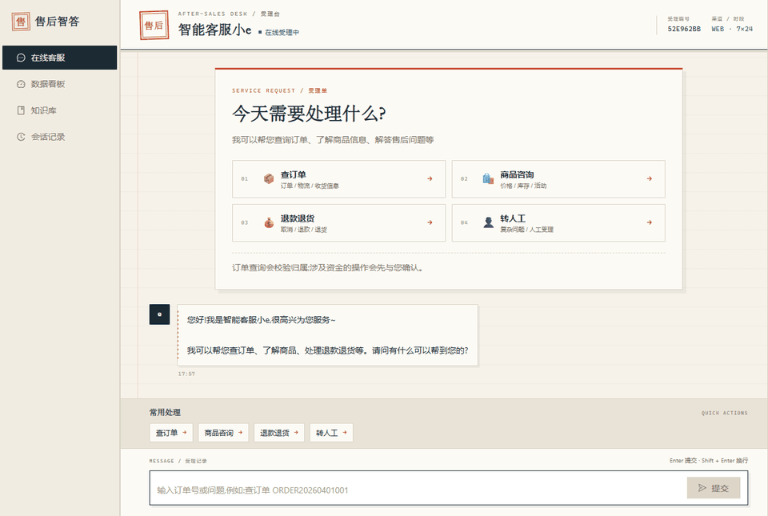

### 智能对话

| 欢迎页 | 订单查询(意图 / 情感 / 工具调用) |
| --- | --- |
| 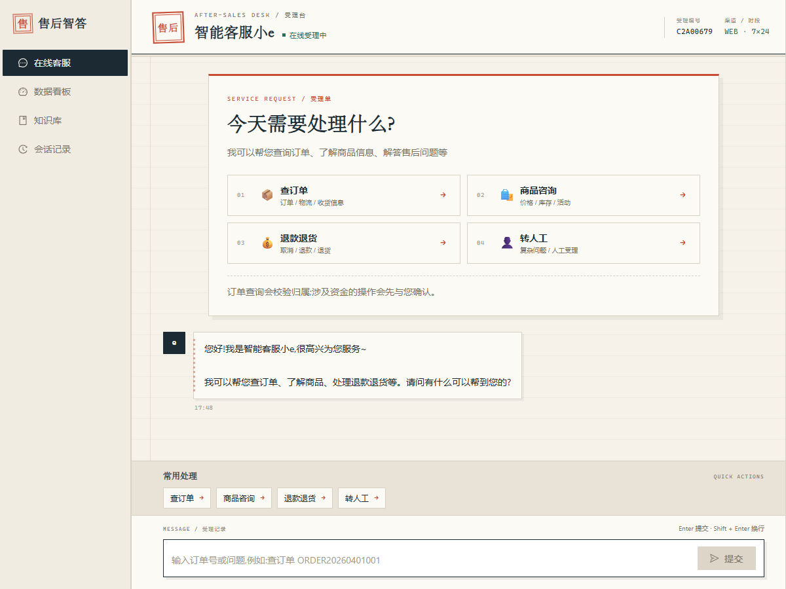 | 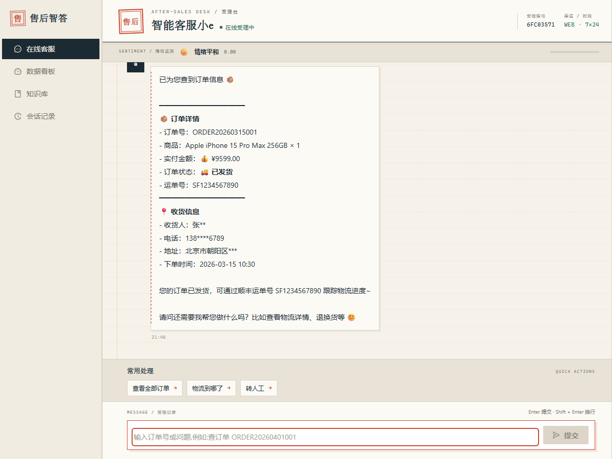 |

| RAG 回答 + 结构化引用 | 复合任务:生成取消申请(待确认) |
| --- | --- |
| 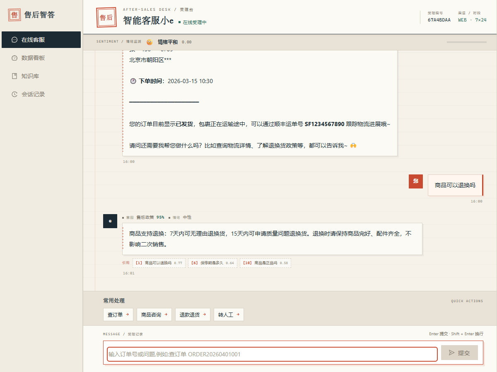 | 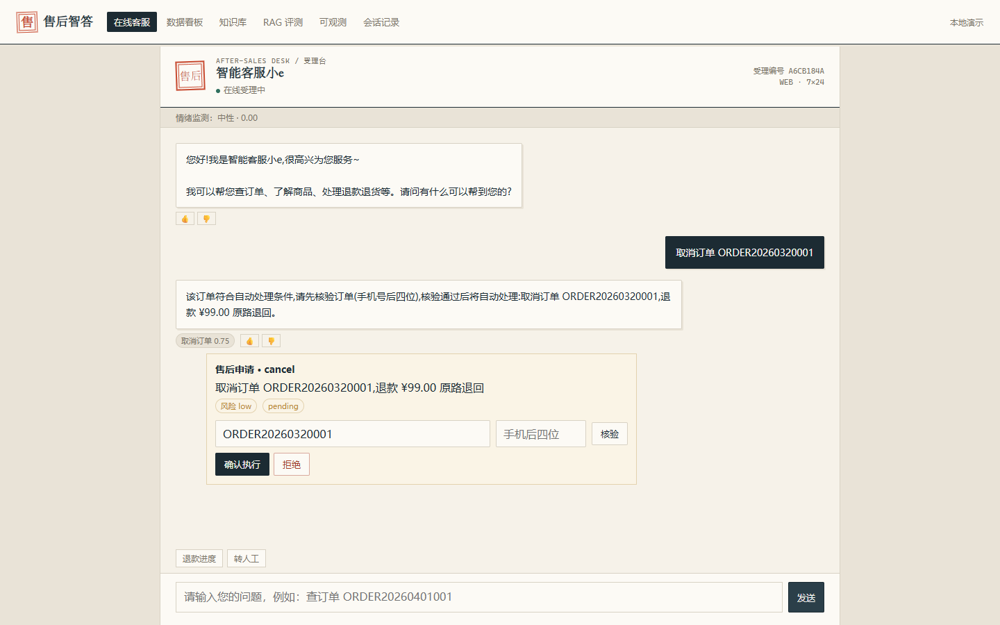 |

| 审批执行结果(核验后确认) | 投诉转人工(负向情感 + 排队信息) |
| --- | --- |
| 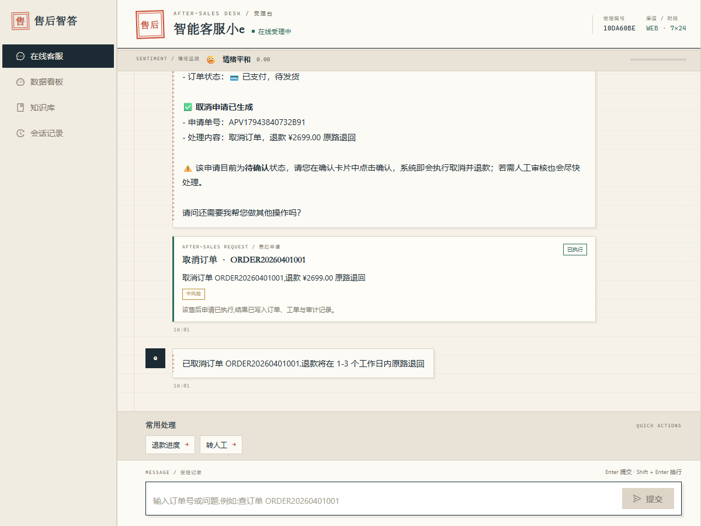 | 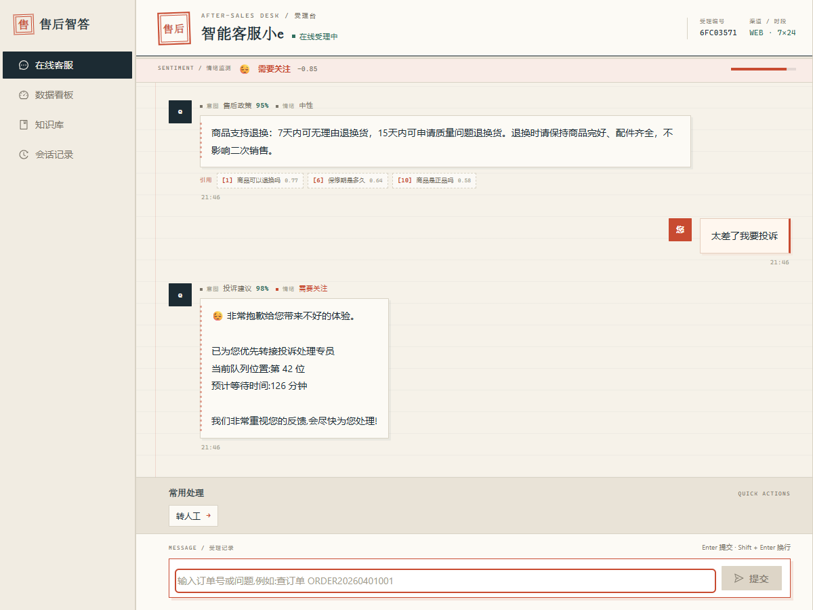 |

### 数据看板 / 知识库 / 会话记录

| 数据看板 | 知识库管理 |
| --- | --- |
| 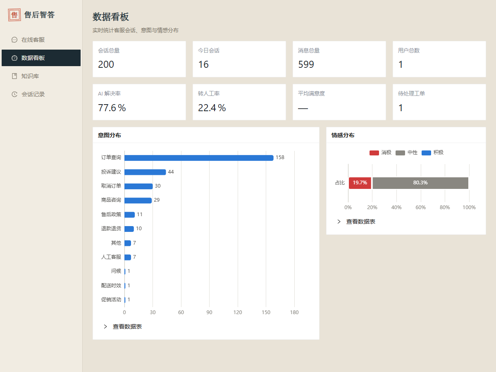 | 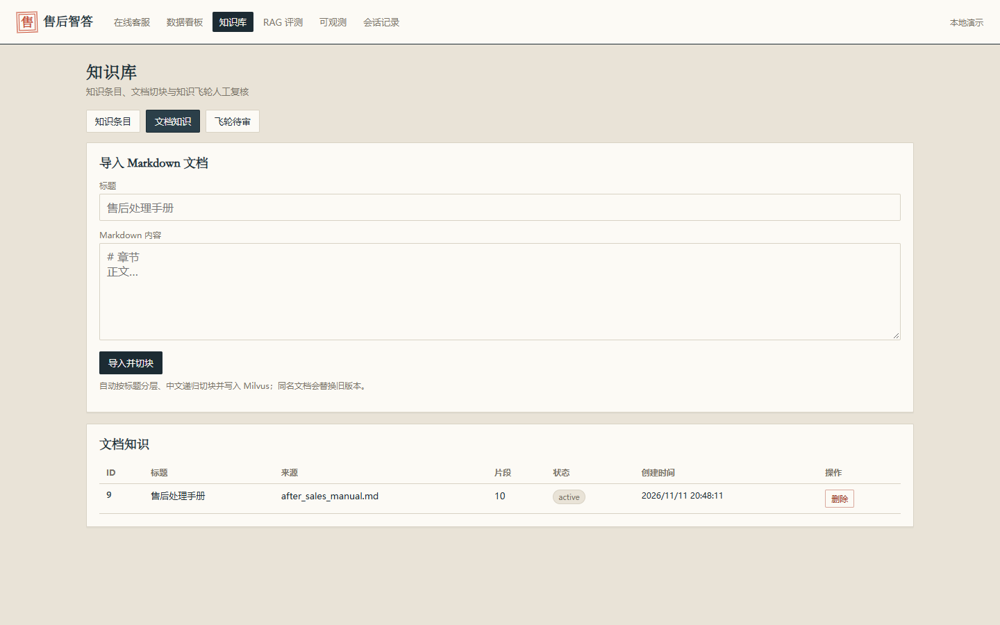 |

| 会话记录(完整对话回放) | RAG 评测看板 |
| --- | --- |
| 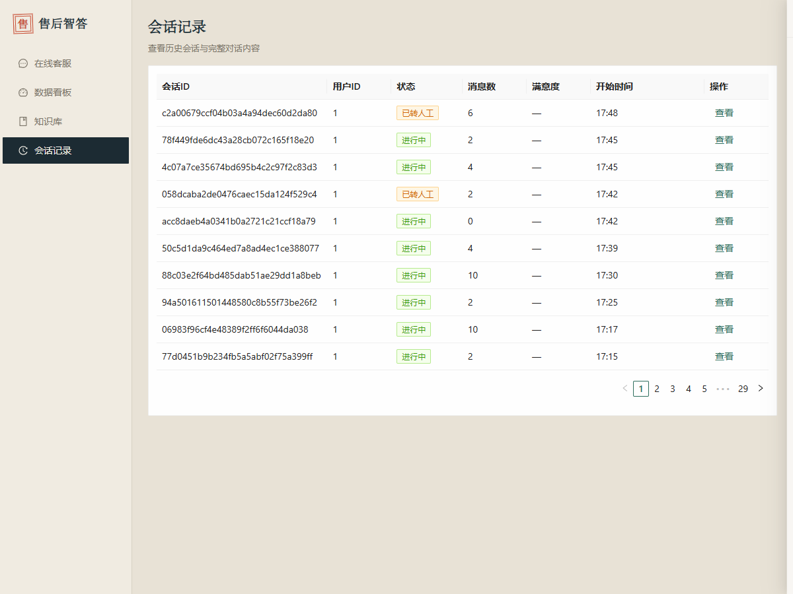 | 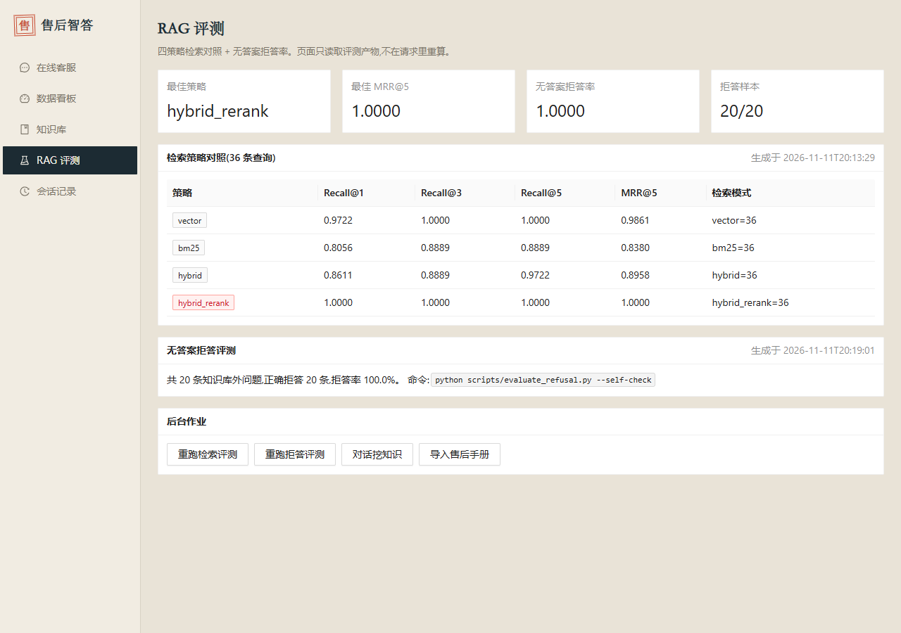 |

> 展示数据均为虚构种子;对话截图中的手机号、姓名与详细地址已脱敏。

## 技术栈

| 层 | 技术 |
| --- | --- |
| 前端 | 原生 HTML5、CSS3、JavaScript(ES2020)、fetch / SSE,无构建步骤 |
| 后端 | FastAPI、SQLAlchemy 2(async)、Pydantic 2、loguru |
| 数据 | MySQL 8、Redis 7、Milvus 2.5(本地存储模式) |
| AI | DeepSeek(OpenAI 兼容)、LangGraph + LangChain、sentence-transformers(BGE 向量 + bge-reranker 重排) |
| 工具协议 | MCP 2.x(独立 Server + Streamable HTTP 客户端) |
| 图状态 | LangGraph checkpointer:SQLite 默认,Postgres 可选 |
| 可观测 | Langfuse 5.x(LangGraph 回调 + OpenAI generation 埋点) |
| 安全 | PyJWT(HS256)、bcrypt、纯 ASGI 鉴权/限流中间件 |
| 测试 | pytest、pytest-asyncio |

## 架构

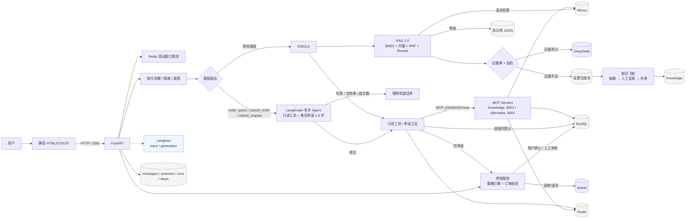

> 一次完整请求的链路、单步/多步对比与模块职责见
> [ARCHITECTURE.md](docs/ARCHITECTURE.md);
> LangGraph 主路径与 fallback 的决策背景见
> [ADR-0001](docs/adr/0001-langgraph-primary-agent.md);
> MCP 工具服务化的边界与回退策略见
> [ADR-0002](docs/adr/0002-mcp-tool-service.md)。

## 目录结构

```text
after-sales-qa/
├── backend/
│   ├── app/
│   │   ├── api/v1/          # 对话/SSE、认证、意图、Agent、审批、知识飞轮、知识库、订单、商品、分析
│   │   ├── agents/          # Agent、6 个工具、工具注册表/执行引擎、LangGraph 多步图 + checkpointer、MCP 代理
│   │   ├── mcp/             # 两个独立 MCP Server:知识/商品 8001、订单/售后 8002
│   │   ├── core/            # 配置、数据库、种子、鉴权、熔断、限流、后台作业、Langfuse 观测
│   │   ├── models/          # 22 张表的 ORM 模型(任务/审批/策略/核验/审计/飞轮/文档)
│   │   ├── policies/        # 策略引擎:规则匹配 + 决策审计
│   │   ├── runtime/         # 任务运行时:事项 / 运行步骤 / 审批执行
│   │   ├── schemas/         # Pydantic 模型(含 citation / approval / interrupt)
│   │   ├── services/        # LLM / 检索 / 重排 / 证据闸 / 自检 / 记忆 / 飞轮 / Skills / 保留期
│   │   └── utils/           # 日志、缓存与限流、PII 脱敏、引用构建
│   ├── skills/              # 按意图加载的运维指令包(*.md)
│   ├── data/                # SQLite checkpointer(gitignore)
│   ├── scripts/             # init_db / evaluate_rag / import_documents / mine_knowledge / retention_cleanup 等
│   ├── tests/               # pytest(服务/图/策略/审批/检索/SSE/飞轮/鉴权/checkpointer + API 集成)
│   ├── requirements.txt
│   └── requirements-dev.txt
├── frontend/
│   └── static/              # 原生 HTML/CSS/JS,无构建步骤
│       ├── *.html           # 登录 / 聊天 / 看板 / 知识库 / 评测 / 可观测 / 会话
│       ├── css/app.css
│       └── js/              # 公共 API/Auth、各页面脚本、SSE 解析
├── config/                  # Agent 行为与售后策略配置
├── knowledge_base/          # 知识库 JSON 与 RAG 评测集
├── docker/                  # 开发/生产/Langfuse compose、Dockerfile、nginx
├── scripts/                 # 演示 GIF 合成
└── docs/                    # 架构 / API / 数据库 / 部署 / 评测 / 面试材料 / ADR
```

## 快速开始(开发模式)

### 1. 启动基础设施

需要 Docker Desktop 已启动。

```bash
docker compose -f docker/docker-compose.dev.yml up -d
docker compose -f docker/docker-compose.dev.yml ps
```

启动内容:MySQL(3306)、Redis(6379)、etcd、Milvus(19530 / 9091)。

### 2. 启动后端

```bash
cd backend

# 首次:创建虚拟环境并安装依赖
python -m venv venv
# Windows
venv\Scripts\activate
# Linux/macOS
# source venv/bin/activate
pip install -r requirements.txt
# 仅开发/跑测试:GIF 合成、pytest 等
# pip install -r requirements-dev.txt

# 配置环境变量
copy .env.example .env        # Windows
# cp .env.example .env        # Linux/macOS

# 启动(首次会下载 BGE 向量模型,约 100MB)
uvicorn app.main:app --reload --host 127.0.0.1 --port 8000
```

- API 文档:http://127.0.0.1:8000/docs
- 健康检查:http://127.0.0.1:8000/health

首次启动会自动建表并写入演示数据(用户、意图、商品、订单、知识库),并向量化知识条目。

### 3. 打开前端

后端已直接托管静态页面,无需安装 Node/构建:

- 受理台:http://127.0.0.1:8000/
- 登录(开启鉴权时):http://127.0.0.1:8000/login
- 可观测:http://127.0.0.1:8000/observability

Docker 部署入口为 http://localhost:8080。

### 4. 配置 LLM(可选)

默认使用 **mock 模式**(未配置 Key 时返回演示回复,订单、RAG、转人工与看板等链路仍可用)。

使用 DeepSeek:编辑 `backend/.env`:

```env
LLM_PROVIDER=deepseek
LLM_API_KEY=sk-你的key
LLM_API_BASE=https://api.deepseek.com/v1
LLM_MODEL=deepseek-chat
```

重启后端生效。多步 Agent 与复合任务在真实 LLM 模式下走 `multi_step`;
未配置 Key 时走单步离线模式,订单查询、RAG 与转人工仍可用。

## 测试

### 后端 pytest

需要基础设施容器运行(测试使用真实 MySQL/Redis/Milvus)。当前 **137 个测试**:

```bash
cd backend
pip install -r requirements-dev.txt   # 已装可跳过
./venv/Scripts/python.exe -m pytest -q
```

覆盖:

- **服务单测**:情感规则、意图与实体抽取、PII 脱敏、RAG 引用构建、评测指标计算;
- **RAG 2.0**:子句拆分、RRF 融合、首尾重排、证据置信度四信号;
- **文档切块**:Markdown 标题分层、中文递归切分、句级 overlap;
- **回答校验**:订单号/金额/日期实体抽取与证据比对;
- **候选去重**:标准化 + 词面相似度,避免近似重复知识进入审核队列;
- **策略与运行时**:规则匹配/优先级/默认拒绝、事项复用、审批状态机;
- **图单测**:单工具路径、复合任务(查询 → 提交申请)、知识检索引用、图失败、
  空回复、无工具结果、6 步上限、历史传递;checkpointer + 订单选择/工单确认
  interrupt/resume;确定性路由图分支;
- **API 集成**:多步订单查询、复合任务生成审批单、核验后执行、重复确认幂等、
  策略拒绝/转人工、跨会话越权、强制图失败强停兜底、转人工、订单越权校验、
  RAG 引用与历史回放、SSE 事件流、知识飞轮队列/采纳/弃用、文档导入、
  用户反馈入池、评测看板、候选去重、后台作业、认证/RBAC、订单选择 resume;
- **MCP**:知识/商品 + 订单/售后两个 Server 拆分、6 个工具注册、
  DB Session 与 user/session 注入、多 Server 动态清单与缓存、
  代理 Schema 隐藏上下文字段、远程调用解析、只读工具传输失败回退、
  副作用工具不回退/不重试;
- **安全/韧性**:JWT 登录/注册/改密、短信/扫码登录、租户隔离、
  管理员路由 403、会话/订单归属;熔断器开断/半开/关闭、
  Redis 可选与内存降级、数据保留期 dry-run/删除;
- **管理/观测**:管理员用户 CRUD、最后管理员保护、token 版本失效、
  运行概览/轨迹回放/Token 成本、checkpoint TTL 清理;
- **上下文**:摘要边界切窗、语义历史排序、Skills 按意图加载;
- **可观测**:Langfuse 未配置时 no-op、trace 元数据(session/user/tags);
- **限流单测**:滑动窗口计数、过期与 Redis 故障 fail-open/降级;
- 测试通过 FastAPI `dependency_overrides` 注入脚本化 Fake ChatModel,
  并强制 `LLMService` 进入 mock,不会访问真实 DeepSeek。

### 静态页面自检

后端启动后直接访问 http://127.0.0.1:8000/ :

- 聊天页:发消息、订单查询、RAG 引用、订单选择/工单确认卡;
- 管理页:看板 / 知识库 / RAG 评测 / 可观测 / 会话记录(需 admin 或本地演示模式);
- 登录页:开启 `AUTH_ENABLED=true` 后访问 `/login`。

演示 GIF 已生成于 `docs/images/demo.gif`,不需要 Node/Playwright。

## RAG 评测

评测集位于 `knowledge_base/eval_set.json`,每条样本是「问题 → 期望知识条目 id」,
当前覆盖 12 个知识条目的 36 条查询。评测只衡量检索排序质量,不评估生成答案。

```bash
cd backend
./venv/Scripts/python.exe scripts/evaluate_rag.py --strategy all
```

`--strategy` 支持 `vector / bm25 / hybrid / hybrid_rerank / all`。
默认只评 FAQ,自动排除文档片段;加 `--include-chunks` 可对照文档切块影响。
本机实测(Milvus + BGE + bge-reranker,12 条种子知识,36 条查询):

| 策略 | Recall@1 | Recall@3 | Recall@5 | MRR@5 |
| --- | --- | --- | --- | --- |
| vector | 0.9722 | 1.0000 | 1.0000 | 0.9861 |
| bm25 | 0.8056 | 0.8889 | 0.8889 | 0.8380 |
| hybrid | 0.8611 | 0.9444 | 1.0000 | 0.9060 |
| **hybrid_rerank** | **1.0000** | **1.0000** | **1.0000** | **1.0000** |

无答案拒答评测(20 条知识库外问题,证据闸 + LLM 自检):**20/20,拒答率 1.0000**。
文档切块导入后的对照(10 个片段)会改变排序口径,单独记录在
[docs/RAG_EVAL.md](docs/RAG_EVAL.md);主表仍是 12 条种子 FAQ 的结果。

评测命令、分类别结果与原始 JSON 见 [docs/RAG_EVAL.md](docs/RAG_EVAL.md)。

## MCP 工具服务

6 个 Agent 工具(知识检索、订单、商品、售后申请、转人工、工单)由两个独立
MCP Server 通过 **Streamable HTTP** 暴露。后端默认走进程内工具;显式开启后,
`McpToolProxy` 会把 `ToolContext` 里的 user / session / 原始消息注入调用,
**不把上下文参数暴露给模型**。工具清单动态拉取并缓存 60 秒,Server 侧新增
工具无需重启后端;只有幂等只读工具在传输失败时回退本地,写/申请/转人工
返回 `MCP_RESULT_UNKNOWN`,不会因为超时重试制造重复工单或审批。

本地开发:

```bash
cd backend
# 终端 1:知识与商品工具(8001)
./venv/Scripts/python.exe -m app.mcp knowledge
# 终端 2:订单与售后工具(8002)
./venv/Scripts/python.exe -m app.mcp aftersales

# backend/.env
MCP_ENABLED=true
MCP_KNOWLEDGE_URL=http://127.0.0.1:8001/mcp
MCP_AFTERSALES_URL=http://127.0.0.1:8002/mcp

# 验证
curl http://127.0.0.1:8001/health
curl http://127.0.0.1:8002/health
```

Docker 部署会启动 `cs-mcp-knowledge` 与 `cs-mcp-aftersales` 两个容器,
后端分别通过 `http://mcp-knowledge:8001/mcp`、
`http://mcp-aftersales:8002/mcp` 调用;端口只在 Docker 内部网络可达,
不映射到宿主机。MCP Server 无公网鉴权,不要直接暴露到公网。

## 可观测(Langfuse)

已引入 `langfuse>=5.2`。配置以下三项后自动开启,否则完全 no-op:

```bash
LANGFUSE_PUBLIC_KEY=pk-lf-...
LANGFUSE_SECRET_KEY=sk-lf-...
LANGFUSE_BASE_URL=https://cloud.langfuse.com   # 或自建 Langfuse 地址
LANGFUSE_TRACING_ENVIRONMENT=development       # 可选
```

- LangGraph 的模型节点 / 工具节点通过 `CallbackHandler` 上报,
  metadata 写入 `langfuse_session_id`、`langfuse_user_id`、trace 名称与 tags;
- 原生 OpenAI 调用(DeepSeek 兼容)通过 `langfuse.openai.AsyncOpenAI` 自动记录
  generation:模型、token、延迟、输入输出;
- 聊天入口创建根 span 并写入 session/user/tags;即使 LLM 走 mock 模式,
  也会留下一条可观测的 trace,LangGraph/OpenAI span 会挂在根 span 下;
- 应用关闭时 `flush + shutdown`,避免最后一批 span 丢失。

本地一键自托管(可选):

```bash
docker compose -f docker/docker-compose.langfuse.yml up -d
# 国内/镜像源(本机已用此方式验证):
DOCKER_MIRROR=docker.1ms.run \
MINIO_IMAGE=docker.1ms.run/chainguard/minio:latest \
  docker compose -f docker/docker-compose.langfuse.yml up -d
# 界面:http://localhost:3000
# 默认账号:admin@after-sales.local / after-sales-123
```

compose 已用 headless 初始化项目 key:

```bash
LANGFUSE_PUBLIC_KEY=pk-lf-after-sales-local
LANGFUSE_SECRET_KEY=sk-lf-after-sales-local
LANGFUSE_BASE_URL=http://127.0.0.1:3000
```

对象存储使用 Chainguard MinIO 镜像,规避官方 MinIO 镜像停止分发的问题;
这些默认密钥仅用于本地演示,对外部署前必须替换。
本机已实测:Web `/api/public/health` 返回 OK,发送真实 trace 后
`/api/public/traces` 可查询到记录。

## 认证与 RBAC

默认 `AUTH_ENABLED=false`,本地演示不需要登录;开启后保护 `/api/v1/*`
(登录/注册/`/auth/config` 放行),管理员接口额外要求 admin 角色。

```bash
AUTH_ENABLED=true
JWT_SECRET_KEY=<至少 32 字节的随机密钥>
```

```bash
curl -X POST http://127.0.0.1:8000/api/v1/auth/login \
  -H "Content-Type: application/json" \
  -d '{"username":"demo_admin","password":"admin123"}'
# 之后请求带 Authorization: Bearer <token>
```

演示账号:`demo_customer/demo123`、`demo_agent/agent123`、
`demo_admin/admin123`。生产部署前必须修改密码与 JWT 密钥。

短信 / 扫码登录(需 `AUTH_ENABLED=true`):

- `POST /api/v1/auth/sms/send` → 发送验证码;`SMS_DEBUG_RETURN_CODE=true`
  时响应带 `debug_code`;`POST /api/v1/auth/sms/login` 登录/自动建号;
- `POST /api/v1/auth/qr/start` → 票据;已登录用户 `POST /api/v1/auth/qr/approve`;
  `GET /api/v1/auth/qr/status?ticket=...` 轮询并领取 token;
- 注册/管理员建用户可指定 `tenant_id`,会话按租户隔离。

## 中断与恢复

多步图默认使用 SQLite checkpointer;模型要提交售后申请但缺订单号时会暂停,
返回 `thread_id` + `interrupt.orders`,前端选择后调用:

```bash
POST /api/v1/chat/resume
{"session_id":"...","thread_id":"...","resume":{"type":"select_order","order_no":"..."}}
```

interrupt 只做 slot-filling,真正执行仍走审批单/策略引擎/订单核验。
多副本可切 `CHECKPOINTER_BACKEND=postgres`(需额外 PostgreSQL DSN)。

## 韧性与运维

- **Redis 可选**:`REDIS_URL` 留空时限流走内存窗口、转人工只落 DB;
  配置后启用 Redis 限流/排队位置提示。
- **熔断**:`CIRCUIT_BREAKER_ENABLED` + 失败阈值/冷却时间,
  覆盖 chat / embedding / rerank;401/402/403 不重试。
- **数据保留期**:`RETENTION_ENABLED=true` 后按 `RETENTION_DAYS_*` 分批清理;
  `retention-dry-run` 作业只统计不删除。
- **Skills**:`SKILLS_ENABLED=true` 时按意图加载 `backend/skills/*.md`,
  只追加系统提示词,不改代码路径。
- **上下文**:摘要边界按 `summary_upto_message_id` 切窗;
  `SEMANTIC_HISTORY_ENABLED=true` 时补捞被滑窗丢弃的相关历史。

## Docker 整体部署

Docker 部署时密钥只从环境变量注入,不要提交到仓库或写进 compose 文件。
开发模式可以放在已被 `.gitignore` 忽略的 `backend/.env`。
如果 Key 存放在 `DEEPSEEK_API_KEY` 中,启动时映射给 compose 读取的 `LLM_API_KEY`:

```bash
# Git Bash / Linux / macOS
LLM_API_KEY="$DEEPSEEK_API_KEY" docker compose -f docker/docker-compose.yml up -d --build

# PowerShell
# $env:LLM_API_KEY = $env:DEEPSEEK_API_KEY
# docker compose -f docker/docker-compose.yml up -d --build

# Windows CMD
# set LLM_API_KEY=%DEEPSEEK_API_KEY%
# docker compose -f docker/docker-compose.yml up -d --build
```

未提供 Key 时后端自动进入 mock 模式,订单、RAG、转人工与看板等功能仍可用。

- 应用入口:http://localhost:8080
- API 文档:http://localhost:8080/docs
- 后端直连:http://localhost:8000
- MCP 工具服务:仅容器内 `http://mcp:8001/mcp`(不映射宿主机)
- 服务清单:`mysql / redis / etcd / milvus / mcp-knowledge / mcp-aftersales / backend / frontend / nginx`

> Windows 默认禁止绑定 80 端口,因此 Nginx 映射为 8080。
> 若 80 端口可用,可将 `docker/docker-compose.yml` 中 nginx 的端口改回 `"80:80"`。

停止:

```bash
docker compose -f docker/docker-compose.yml down
```

## 主要 API

| 方法 | 路径 | 说明 |
| --- | --- | --- |
| POST | `/api/v1/chat/session` | 创建会话 |
| POST | `/api/v1/chat/send` | 发送消息(意图/情感/工具调用/引用/待审批) |
| POST | `/api/v1/chat/send-stream` | SSE 流式发送(meta/delta/tool/citations/actions/done) |
| GET | `/api/v1/chat/history` | 历史消息(含 citations / 审批状态 / 证据状态) |
| POST | `/api/v1/feedback` | 回答反馈(👎 进入低置信度池) |
| GET | `/api/v1/rag-eval/overview` | RAG 检索与拒答评测概览 |
| GET/POST | `/api/v1/jobs`、`/api/v1/jobs/{name}` | 后台作业列表/启动/状态/停止 |
| POST | `/api/v1/chat/verify-order` | 订单核验(订单号 + 手机后四位) |
| POST | `/api/v1/chat/approvals/{id}/approve` | 确认/审核售后申请并执行 |
| POST | `/api/v1/chat/approvals/{id}/reject` | 拒绝售后申请 |
| GET | `/api/v1/chat/approvals` | 会话审批列表 |
| GET | `/api/v1/review/queue` | 知识飞轮待审队列 |
| POST | `/api/v1/review/mine` | 从低置信度问题抽取候选知识 |
| POST | `/api/v1/review/{id}/approve` | 采纳候选知识并写入知识库 |
| POST | `/api/v1/review/{id}/discard` | 弃用候选知识 |
| POST | `/api/v1/chat/transfer` | 转人工 |
| POST | `/api/v1/chat/rate` | 会话评分 |
| POST | `/api/v1/intent/recognize` | 意图识别 |
| GET | `/api/v1/agent/info` | Agent 信息 |
| GET | `/api/v1/agent/tools` | 工具列表 |
| GET/POST/PUT/DELETE | `/api/v1/knowledge/*` | 知识库管理 |
| GET | `/api/v1/knowledge/documents` | 文档知识列表 |
| POST | `/api/v1/knowledge/documents/import` | 导入/替换 Markdown 文档(自动切块与向量化) |
| POST | `/api/v1/knowledge/search` | 混合检索 |
| GET | `/api/v1/order/list`、`/api/v1/order/{order_no}` | 订单查询(PII 脱敏) |
| GET | `/api/v1/product/list`、`/api/v1/product/{sku}` | 商品查询 |
| GET | `/api/v1/analytics/summary` | 核心指标 |
| GET | `/api/v1/analytics/sessions` | 会话列表 |

详见 [docs/API_SPEC.md](docs/API_SPEC.md)。

## 数据维护脚本

```bash
cd backend

# 建表 + 种子数据
python scripts/init_db.py

# 批量导入知识库 JSON(自动去重并向量化)
python scripts/import_knowledge.py --file ../knowledge_base/faqs.json

# 重建向量索引(--rebuild 会按 BM25 schema 重建 collection,混合检索需要)
python scripts/init_vector_db.py --rebuild

# 恢复演示订单状态(重复演示复合任务前)
python scripts/reset_demo_data.py

# 导入 Markdown 文档知识(自动切块 + 向量化)
python scripts/import_documents.py --file ../knowledge_base/after_sales_manual.md --title 售后处理手册

# 从低置信度问题抽取候选知识(写入待审队列)
python scripts/mine_knowledge.py

# RAG 检索离线评测(四策略对照)
python scripts/evaluate_rag.py --strategy all

# 无答案拒答评测(证据闸 + LLM 自检)
python scripts/evaluate_refusal.py --self-check
```

## 技术选型说明

| 选型 | 实现 | 说明 |
| --- | --- | --- |
| 前端 | 原生 HTML/CSS/JS + fetch/SSE | 无构建步骤,后端/nginx 直接托管,部署简单 |
| 向量库 | Milvus 2.5.4(本地存储模式) | 适配 Python 3.13;单机部署无需 MinIO |
| Embedding | 本地 BGE small zh v1.5(512 维) | 中文语义检索,可离线运行 |
| LLM | DeepSeek(OpenAI 兼容) | 未配置 Key 时自动进入 mock,便于开发与测试 |
| Agent 编排 | LangGraph 多步主路径 + 单步 fallback | 展示多步工具调用,同时保留稳定兜底路径 |
| 限流 | Redis + Lua 原子滑动窗口 | 计数随窗口滚动过期,避免持续流量下永久 429 |
| PII | 手机号 / 姓名 / 地址脱敏 | 工具输出与订单 API 统一处理,原始数据留库 |
| 售后审批 | 模型只提申请 + 审批服务执行 | 写操作不经过模型,确认/审核后幂等执行 |
| 策略引擎 | YAML 规则 + 决策审计 | 金额/状态/风险分级,低风险自动、高风险人工 |
| 订单核验 | 订单号 + 手机后四位 | 敏感操作前校验,核验记录绑定会话 |
| 混合检索 | Milvus BM25 + 向量 + RRF | 互补召回,中文 analyzer;四策略可评测 |
| 重排 | 本地 bge-reranker-base / 远程 rerank | 离线默认,可切 SiliconFlow;失败退回混合顺序 |
| 证据闸 | 四信号置信度 + LLM 自检 | 证据不足拒答,落低置信度池 |
| 知识飞轮 | 抽取 → 人工复核 → 补库 | 模型候选不直接入库,审核后生效 |
| 文档知识 | Markdown 分层 + 中文递归切块 | 长文档可引用到章节片段 |
| 回答校验 | 订单号/金额/日期实体校验 | 机械校验优先于 LLM 裁判 |
| 用户反馈 | 👍 日志 / 👎 入池 | 反馈直接进入知识飞轮 |
| 候选去重 | 标准化 + difflib 相似度 | 近似重复问题不再进审核队列 |
| 后台作业 | 白名单 argv + 子进程 | 页面只能传作业名,传不进 shell |
| MCP | 官方 SDK + Streamable HTTP | 动态工具清单、上下文注入、副作用工具不回退 |
| 可观测 | Langfuse 5.x(可选) | LangGraph 回调 + OpenAI generation + 意图标签;未配置时 no-op |
| 流式对话 | SSE | RAG 路径逐 token,工具路径事件流 |
| 情感分析 | 词典 + 规则 | 处理否定词跨句、感叹号方向等边界情况 |
| 订单工具 | MySQL 真实数据 + 归属校验 | 防止通过订单号越权查看他人订单 |

## 相关文档

- [可复现演示脚本](docs/DEMO.md):5 分钟演示、curl 命令、预期 `agent_mode`、排障
- [RAG 评测报告](docs/RAG_EVAL.md):评测集、指标定义与实测结果
- [架构设计](docs/ARCHITECTURE.md)
- [API 规范](docs/API_SPEC.md)
- [数据库设计](docs/DATABASE_SCHEMA.md)
- [部署指南](docs/DEPLOYMENT.md)
- [ADR-0001:LangGraph 主路径 + 强停兜底](docs/adr/0001-langgraph-primary-agent.md)
- [领域术语](CONTEXT.md)

## 许可证

本项目采用 [MIT License](LICENSE)。
