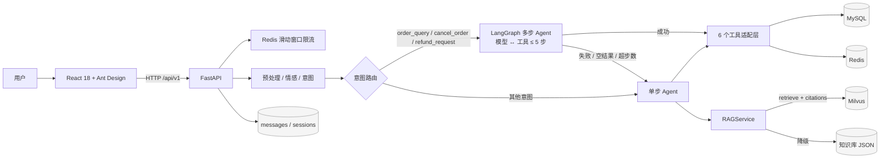

# 售后智答(After-Sales Intelligent Q&A Platform)

基于 **FastAPI + React + MySQL + Redis + Milvus + LangGraph + RAG** 的电商售后智能客服系统。
覆盖意图识别、情感分析、知识库检索增强、多步 Agent 工具调用、复合任务办理、
转人工、数据看板与知识库运营。

> 演示入口:[可复现演示脚本](docs/DEMO.md) · [架构设计](docs/ARCHITECTURE.md) ·
> [ADR-0001:LangGraph 主路径 + Agent Fallback](docs/adr/0001-langgraph-primary-agent.md)

## 功能

- **7×24 智能对话**:多轮上下文、意图路由、快捷回复
- **意图识别**:关键词规则 + LLM 融合,支持订单号/手机号/商品名/价格/日期实体抽取
- **情感分析**:词典 + 规则,负向情绪安抚并自动转人工
- **RAG 知识库**:本地 BGE 中文向量模型 + Milvus 语义检索,回答附带结构化引用(citations)
- **Agent 工具集**:知识检索、订单查询、商品查询、退款/取消、转人工、创建工单
- **多步 Agent**:LangGraph 模型节点 + 工具节点 + 条件边,单请求最多 5 步;
  失败自动回退单步 Agent,响应通过 `agent_mode` 标记实际路径
- **复合任务**:一次请求内完成「查订单 → 判断状态 → 取消/退货」,取消操作真实写库且幂等
- **RAG 评测**:固定评测集 + Recall@1/3/5、MRR@5 离线评测脚本
- **业务安全**:订单查询校验归属;手机号、姓名、收货地址在工具输出与 API 响应中脱敏
- **接口限流**:Redis + Lua 原子滑动窗口,按会话限制每分钟请求数
- **数据看板**:会话/消息/AI 解决率/转人工率/满意度,意图与情感分布
- **知识库管理**:增删改查 + 语义检索,变更自动重建向量
- **会话记录**:历史会话列表与完整对话回放

## 项目亮点

- **复合任务可演示**:模型先调用 `query_order` 读取真实状态,再决定取消还是退货;
  取消只对「待支付 / 已支付」生效,已发货订单引导退货,避免误操作。
- **Agent Fallback 可观测**:图失败、超步数、空结果或 LLM 不可用时自动回退单步 Agent,
  响应用 `agent_mode` 区分 `multi_step` / `single_step` / `single_step_fallback`。
- **RAG 回答可追溯**:检索结果转成 `citations`(知识 id、分类、问题、相似度),
  随聊天响应返回并持久化到消息元数据,会话回放仍可查看来源。
- **RAG 可降级**:向量库或 Embedding 不可用时自动回退关键词 + bigram 检索,
  并带 30 秒冷却,避免每个请求重复重试已宕机的 Milvus。
- **真实数据链路**:8 张 MySQL 表 + Redis + Milvus,不是前端 mock;
  订单查询在工具层校验归属。
- **安全工程**:订单归属校验、PII 脱敏、Redis 原子滑动窗口限流、
  密钥仅从环境变量注入。
- **测试不碰真实 LLM**:42 个 pytest,HTTP 主接缝 + 脚本化 Fake ChatModel,
  覆盖多步图、复合任务、fallback、RAG 引用与评测指标计算。
- **界面设计**:聊天页采用「售后受理台 / Service Docket」风格——暖纸底、
  墨色结构线、朱红印章与账本式消息批注,订单号/时间使用等宽字体。
- **一键复现**:Docker Compose 覆盖 MySQL / Redis / Milvus / 后端 / 前端 / Nginx。

## 界面预览

聊天页采用「售后受理台 / Service Docket」视觉:纸感背景、受理编号抬头、
印章式头像与账本式消息批注;侧栏 Logo 为「售」字印章,与受理台抬头一致。

### 演示 GIF


### 智能对话

| 欢迎页 | 订单查询(意图 / 情感 / 工具调用) |
| --- | --- |
|  |  |

| RAG 回答 + 结构化引用 | 复合任务(查订单 → 取消) |
| --- | --- |
|  |  |

| 投诉转人工(负向情感 + 排队信息) |
| --- |
|  |

### 数据看板 / 知识库 / 会话记录

| 数据看板 | 知识库管理 |
| --- | --- |
|  |  |

| 会话记录(完整对话回放) |
| --- |
|  |

> 展示数据均为虚构种子;对话截图中的手机号、姓名与详细地址已脱敏。

## 技术栈

| 层 | 技术 |
| --- | --- |
| 前端 | React 18、TypeScript、Vite、Ant Design 5、Zustand、axios、ECharts |
| 后端 | FastAPI、SQLAlchemy 2(async)、Pydantic 2、loguru |
| 数据 | MySQL 8、Redis 7、Milvus 2.5(本地存储模式) |
| AI | DeepSeek(OpenAI 兼容)、LangGraph + LangChain、sentence-transformers(BGE 中文向量) |
| 测试 | pytest、pytest-asyncio、Playwright |

## 架构



> 一次完整请求的链路、单步/多步对比与模块职责见
> [ARCHITECTURE.md](docs/ARCHITECTURE.md);
> LangGraph 主路径与 fallback 的决策背景见
> [ADR-0001](docs/adr/0001-langgraph-primary-agent.md)。

## 目录结构

```text
after-sales-qa/
├── backend/
│   ├── app/
│   │   ├── api/v1/          # 对话、意图、Agent、知识库、订单、商品、分析接口
│   │   ├── agents/          # Agent 基类、客服 Agent、6 个工具、LangGraph 多步图
│   │   ├── core/            # 配置、数据库、种子数据、YAML 加载器
│   │   ├── models/          # 8 张表的 ORM 模型
│   │   ├── schemas/         # Pydantic 模型(含 citation)
│   │   ├── services/        # LLM / 情感 / 意图 / Embedding / RAG / RAG 评测
│   │   └── utils/           # 日志、缓存与限流、PII 脱敏、引用构建
│   ├── scripts/             # init_db / import_knowledge / init_vector_db / evaluate_rag
│   ├── tests/               # pytest(服务单测 + 图单测 + API 集成测试)
│   └── requirements.txt
├── frontend/
│   ├── src/
│   │   ├── api/             # axios 封装
│   │   ├── components/      # 聊天气泡、引用标签、输入框、情感指示器、布局
│   │   ├── pages/           # 聊天、看板、知识库、会话记录
│   │   ├── stores/          # Zustand 状态
│   │   └── types/
│   └── scripts/             # Playwright 冒烟测试与演示 GIF
├── config/                  # LLM / 意图 / RAG / Agent 业务配置
├── knowledge_base/          # 知识库 JSON 与 RAG 评测集
├── docker/                  # 开发与生产 compose、Dockerfile、nginx
├── scripts/                 # 演示 GIF 合成
└── docs/                    # 架构 / API / 数据库 / 部署 / 评测 / 面试材料 / ADR
```

## 快速开始(开发模式)

### 1. 启动基础设施

需要 Docker Desktop 已启动。

```bash
docker compose -f docker/docker-compose.dev.yml up -d
docker compose -f docker/docker-compose.dev.yml ps
```

启动内容:MySQL(3306)、Redis(6379)、etcd、Milvus(19530 / 9091)。

### 2. 启动后端

```bash
cd backend

# 首次:创建虚拟环境并安装依赖
python -m venv venv
# Windows
venv\Scripts\activate
# Linux/macOS
# source venv/bin/activate
pip install -r requirements.txt

# 配置环境变量
copy .env.example .env        # Windows
# cp .env.example .env        # Linux/macOS

# 启动(首次会下载 BGE 向量模型,约 100MB)
uvicorn app.main:app --reload --host 127.0.0.1 --port 8000
```

- API 文档:http://127.0.0.1:8000/docs
- 健康检查:http://127.0.0.1:8000/health

首次启动会自动建表并写入演示数据(用户、意图、商品、订单、知识库),并向量化知识条目。

### 3. 启动前端

```bash
cd frontend
npm install
npm run dev
```

访问 http://localhost:5173。

### 4. 配置 LLM(可选)

默认使用 **mock 模式**(未配置 Key 时返回演示回复,订单、RAG、转人工与看板等链路仍可用)。

使用 DeepSeek:编辑 `backend/.env`:

```env
LLM_PROVIDER=deepseek
LLM_API_KEY=sk-你的key
LLM_API_BASE=https://api.deepseek.com/v1
LLM_MODEL=deepseek-chat
```

重启后端生效。多步 Agent 与复合任务在真实 LLM 模式下走 `multi_step`;
未配置 Key 时同一请求会回退单步 Agent,链路仍可用。

## 测试

### 后端 pytest

需要基础设施容器运行(测试使用真实 MySQL/Redis/Milvus)。当前 **42 个测试**:

```bash
cd backend
./venv/Scripts/python.exe -m pytest -q
```

覆盖:

- **服务单测**:情感规则、意图与实体抽取、PII 脱敏、RAG 引用构建、评测指标计算;
- **图单测**:单工具路径、复合任务(查询 → 取消)、知识检索引用、图失败、
  空回复、无工具结果、5 步上限、历史传递;
- **API 集成**:多步订单查询、复合任务真实写库、强制图失败 fallback、
  图内转人工 `need_transfer`、订单越权校验、RAG 引用与历史回放;
- **限流单测**:滑动窗口计数、过期与 Redis 故障 fail-open;
- 测试通过 FastAPI `dependency_overrides` 注入脚本化 Fake ChatModel,
  并强制 `LLMService` 进入 mock,不会访问真实 DeepSeek。

### 浏览器冒烟测试

需要后端(8000)与前端(5173)同时运行;使用系统已安装的 Edge。

```bash
cd frontend
node scripts/smoke.mjs
```

覆盖:欢迎语 → 订单查询(PII 脱敏)→ RAG 引用 → 投诉转人工 →
数据看板 → 知识库 → 会话记录抽屉。

### 演示 GIF

```bash
cd frontend
node scripts/demo-gif.mjs
```

驱动浏览器完成订单查询、RAG 引用与转人工,截图帧由 Pillow 合成为
`docs/images/demo.gif`。

## RAG 评测

评测集位于 `knowledge_base/eval_set.json`,每条样本是「问题 → 期望知识条目 id」,
当前覆盖 12 个知识条目的 36 条查询。评测只衡量检索排序质量,不评估生成答案。

```bash
cd backend
./venv/Scripts/python.exe scripts/evaluate_rag.py
```

输出 Recall@1/3/5、MRR@5、检索模式(vector / keyword)与分类别 Recall@3。
本机实测(Milvus 向量检索,36 条查询):

| Recall@1 | Recall@3 | Recall@5 | MRR@5 |
| --- | --- | --- | --- |
| 0.9722 | 1.0000 | 1.0000 | 0.9861 |

评测命令、分类别结果与原始 JSON 见 [docs/RAG_EVAL.md](docs/RAG_EVAL.md)。

## Docker 整体部署

Docker 部署时密钥只从环境变量注入,不要提交到仓库或写进 compose 文件。
开发模式可以放在已被 `.gitignore` 忽略的 `backend/.env`。
如果 Key 存放在 `DEEPSEEK_API_KEY` 中,启动时映射给 compose 读取的 `LLM_API_KEY`:

```bash
# Git Bash / Linux / macOS
LLM_API_KEY="$DEEPSEEK_API_KEY" docker compose -f docker/docker-compose.yml up -d --build

# PowerShell
# $env:LLM_API_KEY = $env:DEEPSEEK_API_KEY
# docker compose -f docker/docker-compose.yml up -d --build

# Windows CMD
# set LLM_API_KEY=%DEEPSEEK_API_KEY%
# docker compose -f docker/docker-compose.yml up -d --build
```

未提供 Key 时后端自动进入 mock 模式,订单、RAG、转人工与看板等功能仍可用。

- 应用入口:http://localhost:8080
- API 文档:http://localhost:8080/docs
- 后端直连:http://localhost:8000

> Windows 默认禁止绑定 80 端口,因此 Nginx 映射为 8080。
> 若 80 端口可用,可将 `docker/docker-compose.yml` 中 nginx 的端口改回 `"80:80"`。

停止:

```bash
docker compose -f docker/docker-compose.yml down
```

## 主要 API

| 方法 | 路径 | 说明 |
| --- | --- | --- |
| POST | `/api/v1/chat/session` | 创建会话 |
| POST | `/api/v1/chat/send` | 发送消息(意图/情感/工具调用/引用) |
| GET | `/api/v1/chat/history` | 历史消息(含 citations) |
| POST | `/api/v1/chat/transfer` | 转人工 |
| POST | `/api/v1/chat/rate` | 会话评分 |
| POST | `/api/v1/intent/recognize` | 意图识别 |
| GET | `/api/v1/agent/info` | Agent 信息 |
| GET | `/api/v1/agent/tools` | 工具列表 |
| GET/POST/PUT/DELETE | `/api/v1/knowledge/*` | 知识库管理 |
| POST | `/api/v1/knowledge/search` | 语义检索 |
| GET | `/api/v1/order/list`、`/api/v1/order/{order_no}` | 订单查询(PII 脱敏) |
| GET | `/api/v1/product/list`、`/api/v1/product/{sku}` | 商品查询 |
| GET | `/api/v1/analytics/summary` | 核心指标 |
| GET | `/api/v1/analytics/sessions` | 会话列表 |

详见 [docs/API_SPEC.md](docs/API_SPEC.md)。

## 数据维护脚本

```bash
cd backend

# 建表 + 种子数据
python scripts/init_db.py

# 批量导入知识库 JSON(自动去重并向量化)
python scripts/import_knowledge.py --file ../knowledge_base/faqs.json

# 重建全部向量索引(更换模型或 Milvus 数据丢失时)
python scripts/init_vector_db.py

# 恢复演示订单状态(重复演示复合任务前)
python scripts/reset_demo_data.py

# RAG 检索离线评测
python scripts/evaluate_rag.py
```

## 技术选型说明

| 选型 | 实现 | 说明 |
| --- | --- | --- |
| 前端 | React 18 + Ant Design 5 + Zustand | 组件生态成熟,状态管理轻量 |
| 向量库 | Milvus 2.5.4(本地存储模式) | 适配 Python 3.13;单机部署无需 MinIO |
| Embedding | 本地 BGE small zh v1.5(512 维) | 中文语义检索,可离线运行 |
| LLM | DeepSeek(OpenAI 兼容) | 未配置 Key 时自动进入 mock,便于开发与测试 |
| Agent 编排 | LangGraph 多步主路径 + 单步 fallback | 展示多步工具调用,同时保留稳定兜底路径 |
| 限流 | Redis + Lua 原子滑动窗口 | 计数随窗口滚动过期,避免持续流量下永久 429 |
| PII | 手机号 / 姓名 / 地址脱敏 | 工具输出与订单 API 统一处理,原始数据留库 |
| 情感分析 | 词典 + 规则 | 处理否定词跨句、感叹号方向等边界情况 |
| 订单工具 | MySQL 真实数据 + 归属校验 | 防止通过订单号越权查看他人订单 |

## 相关文档

- [可复现演示脚本](docs/DEMO.md):5 分钟演示、curl 命令、预期 `agent_mode`、排障
- [RAG 评测报告](docs/RAG_EVAL.md):评测集、指标定义与实测结果
- [架构设计](docs/ARCHITECTURE.md)
- [API 规范](docs/API_SPEC.md)
- [数据库设计](docs/DATABASE_SCHEMA.md)
- [部署指南](docs/DEPLOYMENT.md)
- [ADR-0001:LangGraph 主路径 + Agent Fallback](docs/adr/0001-langgraph-primary-agent.md)
- [领域术语](CONTEXT.md)

## 许可证

本项目采用 [MIT License](LICENSE)。
