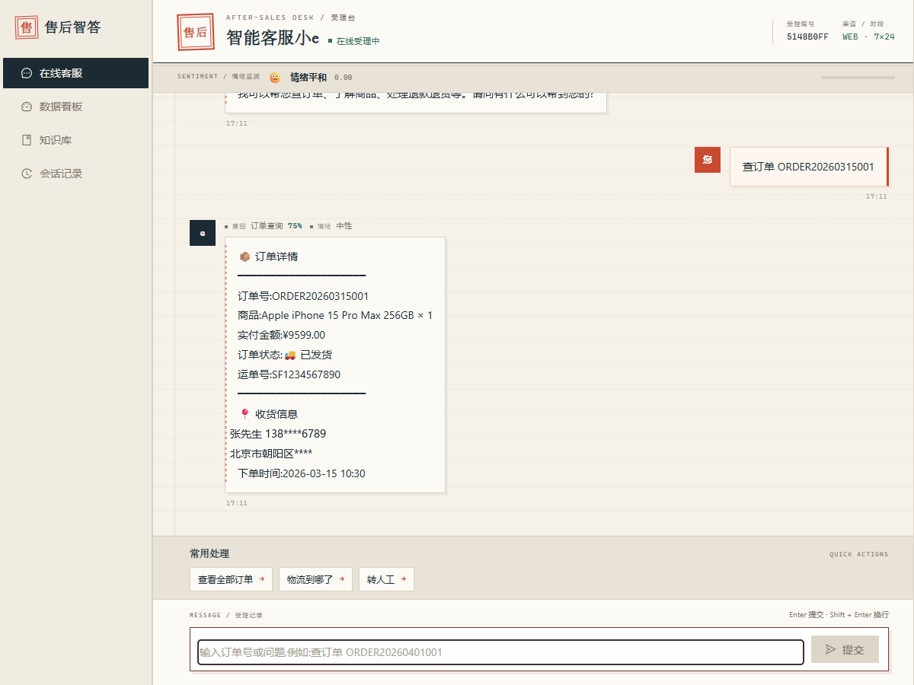
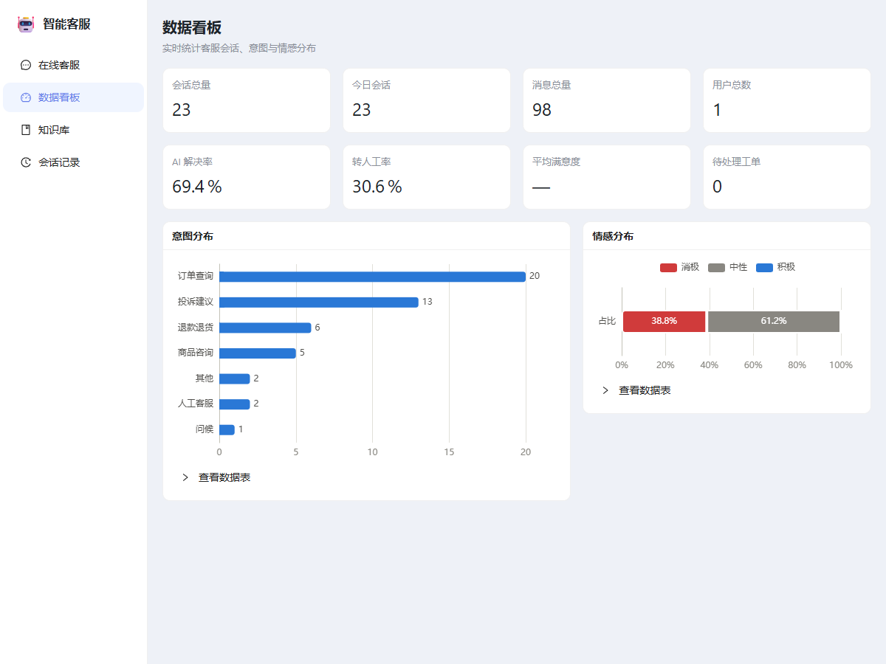
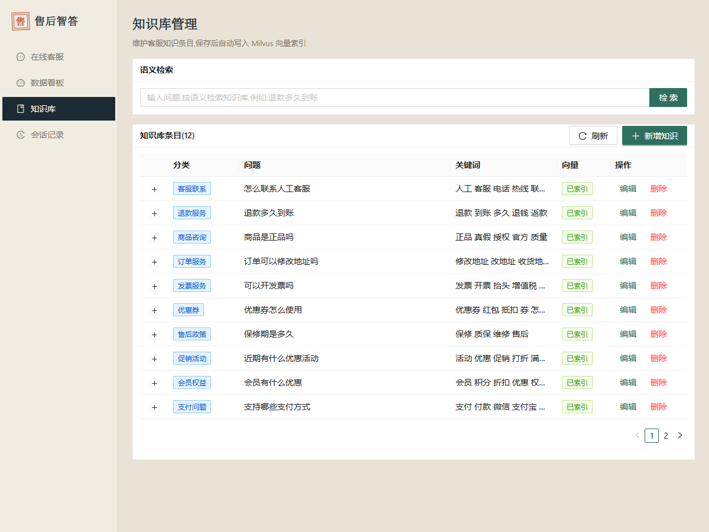
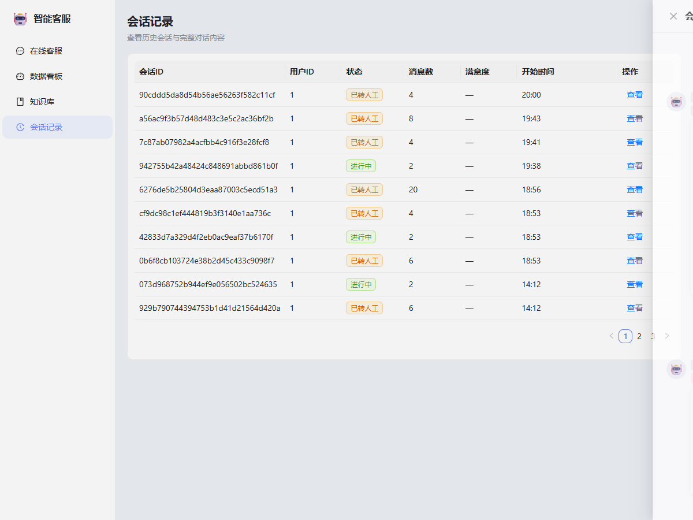
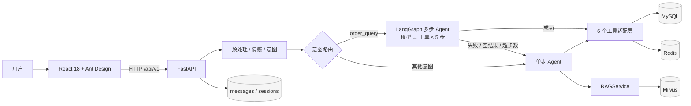

# 售后智答(After-Sales Intelligent Q&A Platform)

基于 **FastAPI + React + MySQL + Redis + Milvus + LLM + RAG** 的售后智答平台。
支持意图识别、情感分析、知识库检索增强、Agent 工具调用、转人工与数据分析看板。

> 前端技术栈为 **React 18**（由 Vue 3 方案调整而来），其余架构保持一致。
>
> 面向 AI/LLM 应用工程师实习的作品集项目。面试材料:
> [可复现演示脚本](docs/DEMO.md) · [ADR-0001](docs/adr/0001-langgraph-primary-agent.md)。

## 功能

- **7×24 智能对话**:多轮上下文、意图路由、快捷回复
- **意图识别**:关键词规则 + LLM 融合,支持实体抽取(订单号/手机号/商品名/价格/日期)
- **情感分析**:词典 + 规则,负向情绪安抚并自动转人工
- **RAG 知识库**:本地 BGE 中文向量模型 + Milvus 语义检索,失败自动降级关键词检索
- **Agent 工具集**:知识检索、订单查询、商品查询、退款/取消、转人工、创建工单
- **多步 Agent**:LangGraph 模型节点 + 工具节点 + 条件边(最多 5 步),订单查询优先走图;失败自动回退单步 Agent(Agent Fallback),响应通过 `agent_mode` 标记实际路径
- **业务安全**:订单查询校验归属,防止越权查看他人订单
- **数据看板**:会话/消息/AI 解决率/转人工率/满意度,意图与情感分布
- **知识库管理**:增删改查 + 语义检索,变更自动重建向量
- **会话记录**:历史会话列表与完整对话回放

## 项目亮点

- **多步 Agent 可演示**:LangGraph 模型节点 + 工具节点 + 条件边,
  模型自主决定调用哪个工具,单请求最多 5 步。
- **Agent Fallback 可观测**:图失败、超步数、空结果或 LLM 不可用时自动回退单步 Agent,
  响应用 `agent_mode` 区分 `multi_step` / `single_step` / `single_step_fallback`。
- **真实数据链路**:8 张 MySQL 表 + Redis + Milvus,不是前端 mock;
  订单查询在工具层校验归属。
- **RAG 可降级**:本地 BGE 中文向量 + Milvus COSINE 检索,
  向量库/Embedding 不可用时自动回退关键词 + bigram 检索。
- **测试不碰真实 LLM**:21 个 pytest,HTTP 主接缝 + 脚本化 Fake ChatModel。
- **一键复现**:Docker Compose 覆盖 MySQL / Redis / Milvus / 后端 / 前端 / Nginx。

## 当前进度

| 能力 | 状态 |
| --- | --- |
| 单步 Agent / RAG / 转人工 / 数据看板 / 知识库 | ✅ 已完成 |
| LangGraph 多步 Agent(订单查询)+ Agent Fallback | ✅ T1 |
| 复合任务(查订单 → 取消/退货) | 🚧 T2 |
| RAG 结构化引用(citations) | 🚧 T3 |
| RAG 评测集 + Recall@1/3/5 | 🚧 T4 |
| 限流修复 + PII 脱敏 | 🚧 T5 |
| 演示 GIF / 新截图 | 🚧 T6 |

> 未完成项在 [已知限制](#已知限制) 中有说明。
> 面试时请如实区分「已实现 / 已验证 / 计划中」,不要虚报评测指标。

## 界面预览

| 智能对话 | 数据看板 |
| --- | --- |
|  |  |

| 知识库管理 | 会话记录 |
| --- | --- |
|  |  |

## 技术栈

| 层 | 技术 |
| --- | --- |
| 前端 | React 18、TypeScript、Vite、Ant Design 5、Zustand、axios、ECharts |
| 后端 | FastAPI、SQLAlchemy 2(async)、Pydantic 2、loguru |
| 数据 | MySQL 8、Redis 7、Milvus 2.5(本地存储模式) |
| AI | DeepSeek(OpenAI 兼容)、LangGraph + LangChain、sentence-transformers(BGE 中文向量) |
| 测试 | pytest、pytest-asyncio、Playwright |

## 架构



> 一次完整请求的链路、单步/多步对比与模块职责见
> [ARCHITECTURE.md](docs/ARCHITECTURE.md);
> LangGraph 主路径与 fallback 的决策背景见
> [ADR-0001](docs/adr/0001-langgraph-primary-agent.md)。

## 目录结构

```text
after-sales-qa/
├── backend/
│   ├── app/
│   │   ├── api/v1/          # 对话、意图、Agent、知识库、订单、商品、分析接口
│   │   ├── agents/          # Agent 基类、客服 Agent、6 个工具、LangGraph 多步图
│   │   ├── core/            # 配置、数据库、种子数据、YAML 加载器
│   │   ├── models/          # 8 张表的 ORM 模型
│   │   ├── schemas/         # Pydantic 模型
│   │   ├── services/        # LLM / 情感 / 意图 / Embedding / RAG
│   │   └── main.py
│   ├── scripts/             # init_db / import_knowledge / init_vector_db
│   ├── tests/               # pytest(服务单测 + API 集成测试)
│   └── requirements.txt
├── frontend/
│   ├── src/
│   │   ├── api/             # axios 封装
│   │   ├── components/      # 聊天气泡、快捷回复、输入框、情感指示器、布局
│   │   ├── pages/           # 聊天、看板、知识库、会话记录
│   │   ├── stores/          # Zustand 状态
│   │   └── types/
│   └── scripts/smoke.mjs    # Playwright 浏览器冒烟测试
├── config/                  # LLM / 意图 / RAG / Agent 业务配置
├── knowledge_base/          # 知识库 JSON
├── docker/                  # 开发与生产 compose、Dockerfile、nginx
└── docs/                    # 架构 / API / 数据库 / 部署 / 面试材料 / ADR
```

## 快速开始(开发模式)

### 1. 启动基础设施

需要 Docker Desktop 已启动。

```bash
docker compose -f docker/docker-compose.dev.yml up -d
docker compose -f docker/docker-compose.dev.yml ps
```

启动内容:MySQL(3306)、Redis(6379)、etcd、Milvus(19530 / 9091)。

### 2. 启动后端

```bash
cd backend

# 首次:创建虚拟环境并安装依赖
python -m venv venv
# Windows
venv\Scripts\activate
# Linux/macOS
# source venv/bin/activate
pip install -r requirements.txt

# 配置环境变量
copy .env.example .env        # Windows
# cp .env.example .env        # Linux/macOS

# 启动(首次会下载 BGE 向量模型,约 100MB)
uvicorn app.main:app --reload --host 127.0.0.1 --port 8000
```

- API 文档:http://127.0.0.1:8000/docs
- 健康检查:http://127.0.0.1:8000/health

首次启动会自动建表并写入演示数据(用户、意图、商品、订单、知识库),并向量化知识条目。

### 3. 启动前端

```bash
cd frontend
npm install
npm run dev
```

访问 http://localhost:5173。

### 4. 配置 LLM(可选)

默认使用 **mock 模式**(未配置 Key 时返回演示回复,其余链路完全可用)。

使用 DeepSeek:编辑 `backend/.env`:

```env
LLM_PROVIDER=deepseek
LLM_API_KEY=sk-你的key
LLM_API_BASE=https://api.deepseek.com/v1
LLM_MODEL=deepseek-chat
```

重启后端生效。

## 测试

### 后端 pytest

需要基础设施容器运行(测试使用真实 MySQL/Redis/Milvus)。当前 **21 个测试**:

```bash
cd backend
./venv/Scripts/python.exe -m pytest -q
```

覆盖:

- 服务单测:情感规则、意图与实体抽取;
- 图单测:单工具路径、图失败、空回复、无工具结果、5 步上限、历史传递;
- API 集成:多步订单查询、强制图失败 fallback、图内转人工 `need_transfer`、订单越权校验;
- 测试通过 FastAPI `dependency_overrides` 注入脚本化 Fake ChatModel,
  并强制 `LLMService` 进入 mock,不会访问真实 DeepSeek。

### 浏览器冒烟测试

需要后端(8000)与前端(5173)同时运行;使用系统已安装的 Edge。

```bash
cd frontend
node scripts/smoke.mjs
```

覆盖:聊天页欢迎语 → 订单查询 → 投诉转人工 → 数据看板 → 知识库 → 会话记录抽屉。

## Docker 整体部署

Docker 部署时密钥只从环境变量注入,不要提交到仓库或写进 compose 文件。
开发模式可以放在已被 `.gitignore` 忽略的 `backend/.env`。
如果 Key 存放在 `DEEPSEEK_API_KEY` 中,启动时映射给 compose 读取的 `LLM_API_KEY`:

```bash
# Git Bash / Linux / macOS
LLM_API_KEY="$DEEPSEEK_API_KEY" docker compose -f docker/docker-compose.yml up -d --build

# PowerShell
# $env:LLM_API_KEY = $env:DEEPSEEK_API_KEY
# docker compose -f docker/docker-compose.yml up -d --build

# Windows CMD
# set LLM_API_KEY=%DEEPSEEK_API_KEY%
# docker compose -f docker/docker-compose.yml up -d --build
```

未提供 Key 时后端自动进入 mock 模式,系统其余功能不受影响。

- 应用入口:http://localhost:8080
- API 文档:http://localhost:8080/docs
- 后端直连:http://localhost:8000

> Windows 默认禁止绑定 80 端口,因此 Nginx 映射为 8080。
> 若 80 端口可用,可将 `docker/docker-compose.yml` 中 nginx 的端口改回 `"80:80"`。

停止:

```bash
docker compose -f docker/docker-compose.yml down
```

## 主要 API

| 方法 | 路径 | 说明 |
| --- | --- | --- |
| POST | `/api/v1/chat/session` | 创建会话 |
| POST | `/api/v1/chat/send` | 发送消息(意图/情感/工具调用) |
| GET | `/api/v1/chat/history` | 历史消息 |
| POST | `/api/v1/chat/transfer` | 转人工 |
| POST | `/api/v1/chat/rate` | 会话评分 |
| POST | `/api/v1/intent/recognize` | 意图识别 |
| GET | `/api/v1/agent/info` | Agent 信息 |
| GET | `/api/v1/agent/tools` | 工具列表 |
| GET/POST/PUT/DELETE | `/api/v1/knowledge/*` | 知识库管理 |
| POST | `/api/v1/knowledge/search` | 语义检索 |
| GET | `/api/v1/order/list`、`/api/v1/order/{order_no}` | 订单查询 |
| GET | `/api/v1/product/list`、`/api/v1/product/{sku}` | 商品查询 |
| GET | `/api/v1/analytics/summary` | 核心指标 |
| GET | `/api/v1/analytics/sessions` | 会话列表 |

详见 [docs/API_SPEC.md](docs/API_SPEC.md)。

## 数据维护脚本

```bash
cd backend

# 建表 + 种子数据
python scripts/init_db.py

# 批量导入知识库 JSON(自动去重并向量化)
python scripts/import_knowledge.py --file ../knowledge_base/faqs.json

# 重建全部向量索引(更换模型或 Milvus 数据丢失时)
python scripts/init_vector_db.py
```

## 与原始方案的差异

| 项 | 原始方案 | 本项目 | 原因 |
| --- | --- | --- | --- |
| 前端 | Vue 3 + Element Plus + Pinia | React 18 + Ant Design + Zustand | 需求方指定 |
| Milvus | v2.3.3 | v2.5.4 | pymilvus 2.3 不支持 Python 3.13 |
| MinIO | 独立 MinIO 容器 | Milvus 本地存储模式 | MinIO 官方镜像自 2025 年起停止公共分发 |
| Python 依赖 | 2024 年初版本 | 2025+ 兼容版本 | 适配 Python 3.13 |
| `uuid==1.30` | 文档列出 | 已移除 | PyPI 上的 typosquat 假包 |
| 情感分析 | 示例规则 | 修复否定词跨句、感叹号方向等 bug | 示例代码存在逻辑错误 |
| 订单工具 | 模拟数据 | 真实 MySQL + 归属校验 | 修复 IDOR 越权风险 |
| 商品/订单工具 | 硬编码 mock | 查询数据库种子数据 | 可演示真实链路 |
| Agent 编排 | 单步 Agent | LangGraph 多步主路径 + 单步 Agent fallback | 展示多步工具调用且保留稳定兜底 |

## 已知限制

> 这一节是面试时主动讲边界的地方:已知问题 + 影响 + 计划,比「没有 bug」更可信。

- **多步 Agent 目前只接入 `order_query`**:复合任务(查订单 → 取消/退货)还在 T2;
  写操作暂时留在单步路径,避免 fallback 重复执行副作用。
- **RAG 还没有结构化引用与评测**:聊天回答基于检索上下文,但未返回 `citations`;
  知识库只有 12 条种子条目,Recall@1/3/5 评测集在 T4。不要虚报召回率。
- **限流实现有已知缺陷**:当前是 `INCR + EXPIRE`,每次请求刷新 TTL,
  持续流量下计数可能永不过期,达到上限后会永久 429;计划 T5 改为分钟桶/滑动窗口。
- **订单 PII 未脱敏**:订单详情仍展示完整手机号/地址,T5 计划做 `mask_phone`/`mask_address`;
  仓库内演示数据均为虚构种子。
- **无 JWT/RBAC**:当前以会话绑定用户身份,订单工具校验归属;
  生产部署前需要补认证、鉴权与审计。
- **无可观测性**:只有 loguru 日志 + message metadata(意图、情感、工具调用、`agent_mode`);
  没有 Tracing、延迟/token/成本指标。
- **无 CI/压测**:测试与构建本地通过,但没有 CI 流水线和生产级性能数据。
- **图每次请求编译**:`MultiStepAgent` 按请求构建并编译图,可缓存优化。
- **SSE 流式输出未实现**:当前一次性返回完整回复。
- 情感分析为词典 + 规则,可替换为模型;意图可扩展为向量召回。
- 前端构建产物约 2.2MB(antd + echarts),可按路由做代码分割。
- `Base.metadata.create_all` 用于开发期建表,生产建议引入 Alembic 迁移。

## 相关文档

- [可复现演示脚本](docs/DEMO.md):3 分钟演示、curl 命令、预期 `agent_mode`、排障
- [架构设计](docs/ARCHITECTURE.md)
- [API 规范](docs/API_SPEC.md)
- [数据库设计](docs/DATABASE_SCHEMA.md)
- [部署指南](docs/DEPLOYMENT.md)
- [ADR-0001:LangGraph 主路径 + Agent Fallback](docs/adr/0001-langgraph-primary-agent.md)
- [领域术语](CONTEXT.md)

## 许可证

本项目采用 [MIT License](LICENSE)。
